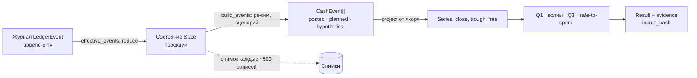
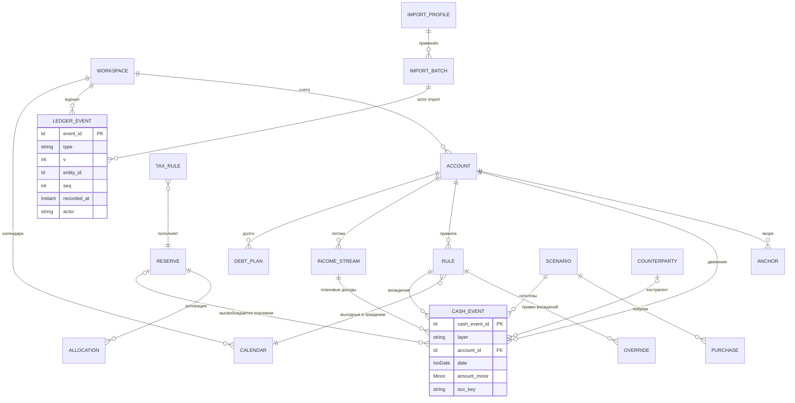

# Модель данных

> Страница фиксирует, **что хранится и как связано**. Определения и формулы — в каноническом ТЗ ([`_ops/design-brief.md`](../../_ops/design-brief.md), раздел 3 и решения раздела 12), решения — [ADR-004](../decisions/adr-004-event-journal-projections.md). Числа примеров — сквозной набор G-001 «Ян»: `as_of` 2026-10-04, **горизонт 57 дн.** (`horizon_end` 2026-11-30, N = 58), буфер 500,00 €. Налоговые поля — данные пользователя; расчёт по введённым правилам, не консультация. Модель данных Budget Guru не раскрыта: заявлено лишь хранение в Supabase ([разбор](../tools/budget-guru.md), не проверено).

Страница приведена к канону v1.1 ([`_ops/canon-decisions.md`](../../_ops/canon-decisions.md): места помечены «C-NNN»); при расхождении приоритет у design-brief v1.1 и этого файла решений.

Принципы: журнал — источник истины, сущности — его проекции (REQ-012); деньги — целые `amount_minor` с валютой ([ADR-002](../decisions/adr-002-money-minor-units.md)); даты — календарные ([ADR-003](../decisions/adr-003-civil-dates.md)); факт, план и гипотеза не смешиваются (D-05); правила, профили и пороги — данные со схемой (REQ-019); у каждого числа есть происхождение (D-21).

## Уровни данных

Два понятия нельзя смешивать: **`LedgerEvent`** — запись журнала («что пользователь сделал и когда»), **`CashEvent`** — датированное движение денег на временной шкале («платёж»). Хранится только журнал (адаптеры создают записи через `make_event`) и кэш-снимки состояния; `CashEvent`, ряды, волны и ответы строятся движком на запрос (`analyze(ws, query)` → `Analysis`, он же контекст `ctx` для `waves`, `afford`, `tools`; C-012) и кэшируются по `inputs_hash`.



## Типы значений

| Тип | Представление | Ограничения и ошибка |
|---|---|---|
| `Id` | строка; для журнала `uuidv7` | непустая; `\|` запрещён в `account_id` и `currency` (ключ дедупликации, `E_SCHEMA`); **единое пространство имён** рабочей области: `rule_id`, `stream_id`, `tax_rule_id`, `reserve_id` и др. не совпадают (`E_SCHEMA`, C-025) |
| `IsoDate` | `'2026-10-04'` на диске, в JSON, в тексте | существующая дата, иначе `E_BAD_DATE` |
| `EpochDay` | целое, 1970-01-01 = 0 (2026-10-04 = 20730); только память движка | перевод на границе: `parse_date`, `format_date` |
| `Minor` | целое, safe-integer | нецелое — `E_NOT_INTEGER`; больше ±(2⁵³−1) — `E_OVERFLOW`; доход > 0, расход < 0 |
| `Currency` | ISO 4217 (`EUR`); для крипты код реестра с `kind: crypto` | неизвестный код отвергается |
| `Bp`, `Minutes` | целые; 10000 bp = 100 % | ставки налога — 0…10000 |
| `Instant` | ISO-8601 UTC, `2026-10-04T08:15:00Z` | только `recorded_at`; в арифметике не участвует |

## Сущности

Поля — `snake_case`, `?` — необязательное. Ограничения взяты из канона (раздел 3, инварианты 3.10) и страниц алгоритмов; выведенные из определений помечены «(вывод)». Нарушение при записи отвергается кодом `E_NOT_INTEGER`, `E_OVERFLOW`, `E_BAD_DATE`, `E_FUTURE_POSTED`, `E_RULE_INVALID`, `E_CURRENCY_MISMATCH`, `E_NO_RATE` или `E_SCHEMA`.

### Workspace и параметры

`Workspace`: `workspace_id`, `name`, `locale` (`ru` или `en`; ES — v1.1), `decision_currency` (по умолчанию валюта первого `operating`-счёта), `params`, `format` (`runway-journal/1`). Ключи `params` плоские, с точкой в имени; значения по умолчанию читаются из `vocab.json`, литералов в коде нет (REQ-019).

| Ключ `params` | По умолчанию | В G-001 |
|---|---|---|
| `horizon_days` | 180 | **57** (задан явно, X2) |
| `buffer_minor` | не задан (`null`): подсказка `buffer_hint`; Q1 и волны считают `B = 0` с предупреждением `W_BUFFER_UNSET`; Q3 и «можно потратить» не отвечают (`insufficient_data`, причина `no_buffer`); явно введённый `0` — «задан» (C-018) | 50000 (подсказка `round_div(7·630000, 90)` = 49000) |
| `wave.threshold_minor` | при создании рабочей области `max(30·10^exp, round_div(Σ исходящих posted за 90 дн., 300))`; нет истории — `30·10^exp` (X1, C-022); хранится числом | 3000 (`max(3000, 2100)` при Σ = 630000) |

Набор исходящих для `threshold_minor` и `buffer_hint` один и тот же (X6, C-022: без переводов между своими счетами, налоговых платежей, аллокаций, ног обмена, `is_exceptional`); функции `outflow_90`, `buffer_hint`, `default_wave_threshold` — экспорты `timeline.mjs`.

Остальные ключи в G-001 — по умолчанию: `headline_mode` = `worse`; `worse.income_delay_days` = 14; `grace_days.income` / `.expense` = 3 / 0; `match.window_days` / `.tol_bp` = 3 / 500; `wave.gap_days` / `.max_span_days` = 3 / 10; `stale.banner_days` / `.block_days` = 7 / 21; `buffer_hint_days` = 7; `explain.top_k` / `.share_cutoff_bp` = 10 / 9000; `rounding` = `half_even`; `ready.q1` / `.q3` = 3 / 4; `crypto.liquidity_bp` = 0. В `vocab.json` и `Workspace.params` живут также гипотезы: `backup.remind_events` / `backup.remind_days` = 50 / 7, `fx.stale_days` = 30 (X10, X11; C-096), `backtest.h_days` / `backtest.min_window_days` = 30 / 14 (C-055), `debt.drift_tol_bp` = 50 (v2, C-040); ключи `kdf.iterations` и `kdf.wrap` зарезервированы (значения определит ADR до v2, C-081); `date_precision` (IDEA-32) зарезервировано для v1.1; параметры калибровки, Монте-Карло и ассистента (гипотезы, design-brief §14 N5): `calib.window` = 24, `calib.prior` = 7, `calib.k` = 3, `calib.alpha_bp` = 3000, `calib.min_origins` = 3, `mc.n_paths` = 2000, `tools.max_calls` = 12. Реестр кодов предупреждений `W_*` (`W_BUFFER_UNSET`, `W_RULE_DISABLED`, `W_RESERVE_BEHIND` и др.) — в `vocab.json`, маска `^[WE]_[A-Z_]+$` (C-021).

### Account

| Поле | Тип | Ограничения | Смысл |
|---|---|---|---|
| `account_id`, `name` | Id, string | `account_id` без `\|` | |
| `kind` | `cash`, `bank`, `savings`, `asset`, `debt`, `crypto` | | природа счёта |
| `liquidity` | `operating`, `savings`, `asset`, `debt` | `crypto` не `operating` (`E_SCHEMA`) | `operating` входит в прогноз, остальные — справочно |
| `currency`, `exponent` | Currency, int | `exponent` из реестра (EUR 2, JPY 0, крипта 8) | валюта и знаки минорной единицы |
| `liquidity_bp` | Bp | 0…10000 (вывод), по умолчанию 0 | доля `asset`/`crypto` в запасе |
| `opened_on`, `closed_on?` | IsoDate | `closed_on ≥ opened_on` (вывод) | |

Запас = Σ `savings` + Σ `asset`·`liquidity_bp`/10⁴ (REQ-018).

### CashEvent

Строится движком из журнала, правил и потоков; в хранилище не пишется.

| Поле | Тип | Ограничения | Смысл |
|---|---|---|---|
| `cash_event_id` | Id | уникален в запросе | для планов — `occ_key` |
| `layer` | `posted`, `planned`, `hypothetical` | | слой (D-05) |
| `account_id`, `currency` | Id, Currency | `currency` = валюта счёта | |
| `date` | IsoDate / EpochDay | `posted`: ≤ `as_of`, иначе `E_FUTURE_POSTED` | гражданская дата; после сдвигов режима — эффективная (`plan`: `base(e)`; `worse`: `base(e)` + сдвиг дохода, D-04) |
| `amount_minor` | Minor | доход > 0, расход < 0 | |
| `kind` | `income`, `expense`, `transfer` | у `transfer` две ноги с общим `transfer_id`, Σ = 0 | |
| `tag`, `note?` | string | **недоверенный текст**; в контекст ассистента не попадает (ADR-013) | метка и заметка пользователя |
| `status?` | `expected`, `matched`, `overdue`, `skipped`, `cancelled` | только `planned` (D-06) | жизненный цикл вхождения |
| `rule_id?`, `occ_key?` | Id, string | `occ_key = (rule_id или stream_id) + '@' + nominal_date` | стабилен при сдвигах |
| `stream_id?` | Id | у событий потока часов и бонусов; тогда `rule_id = null` (C-025) | источник плана-потока; `applies_to.stream_ids` налогового правила сопоставляется с ним |
| `plan_date?` | EpochDay | служебное, результат `build_events`; в журнал не пишется (C-005) | дата после правок сценария и до режима, **без** зажима `max(·, as_of)`; `base(e) = max(plan_date, as_of)`; поля `base_date` нет |
| `orig_amount_minor?`, `orig_currency?`, `rate_used?` | Minor, Currency, `{num, den, date}` | служебные, результат `to_decision_events`; в журнал не пишутся (C-034) | исходная сумма, валюта и курс при переводе в валюту решения |
| `plan_ref?`, `no_plan?` | string, bool | только `posted`-факт (C-051) | связь с планом (`occ_key`) или «не относится к плану»; проставляет свёртка записей `match.set` |
| `is_obligation`, `is_estimate`, `is_exceptional` | bool | в волны — при `amount_minor < 0` и `\|amount_minor\| ≥ θ` | кандидат в волны; фон; вне `burn` |
| `amount_min_minor?`, `amount_max_minor?`, `delay_days_worse?` | Minor, Minor, int | `min ≤ amount ≤ max`; задержка ≥ 0 | коридор суммы; своя задержка в `worse` |
| `reserve_id?`, `scenario_id?`, `purchase_id?`, `transfer_id?` | Id | `scenario_id`, `purchase_id` — только `hypothetical` | связи |
| `fx?`, `counterparty_id?`, `dedup_key?` | `{num, den}`, Id, string | `num, den > 0`; `dedup_key` — 16 hex | выведенный курс; контрагент; ключ импорта |

Соглашения `cash_event_id` в алгоритмах: правило и поток — `occ_key` (`S-HOURLY@2026-11-05`), график долга — `debt_id@дата`, часть покупки — `purchase_id#k`, добавленная сценарием — `scn:<id>:<n>:<k>`. Ключ потока для режима `expected` (v2) и калибровки: `flow_key(e) = counterparty_id ?? stream_id ?? rule_id ?? cash_event_id`; группа цепочки «почему» в движке — `rule_id ?? stream_id ?? tag ?? cash_event_id` (C-025).

### Anchor, Rule, Override, Calendar

| Сущность | Поля | Ограничения |
|---|---|---|
| `Anchor` | `anchor_id`, `account_id`, `date`, `amount_minor` | подтверждённый остаток; проекция стартует от последнего якоря ≤ `as_of` |
| `Rule` | `rule_id`, `version`, `account_id`, `name`, `kind`, `currency` | пара `(rule_id, version)` уникальна; `kind` — `income` или `expense`, знак суммы согласован (расход < 0, доход > 0) |
| | `amount{exp_minor, min_minor?, max_minor?}` | **со знаком**, как у `CashEvent`; `exp_minor ≠ 0`; `min ≤ exp ≤ max` (числовое сравнение со знаком); `validate_rule` проверяет знак (C-001) |
| | `freq`, `interval` | `D`, `W`, `M`, `Y`; `interval ≥ 1` |
| | `by_weekday?`, `by_monthday?`, `by_workday?` | 0 = воскресенье…6 (только `W`; неделя для `by_weekday` — с понедельника); день 1…31, отрицательные — с конца (только `M`); n-й рабочий день (только `M`, не вместе с `by_monthday`); `Y` — без `by_*` (C-002) |
| | `start_date`, `until_date?`, `count?`, `exdates[]` | `until_date ≥ start_date`; `count ≥ 1`; `count` считает номинальные даты после `month_end` и до `exdates`; `until_date` и `exdates` относятся к номинальной дате; при `count` и `until_date` побеждает более ранний предел (C-002) |
| | `month_end`, `weekend`, `calendar_id` | `clamp`/`skip`/`next_first`; `keep`/`prev`/`next`/`skip` |
| | `is_obligation`, `is_estimate`, `tag`, `counterparty_id?`, `delay_days_worse?`, `reserve_id?` | как у `CashEvent` |
| `Override` | `rule_id`, `nominal_date`, `action`, `date?`, `amount_minor?` | ключ `(rule_id, nominal_date)` (индекс по `occ_key`, при повторе ключа побеждает последний, C-003); `move` требует `date`, `set_amount` — сумму (вывод) |
| `Calendar` | `calendar_id`, `name`, `weekend_dows[]`, `holidays[]`, `reviewed_at?` | `weekend_dows` по умолчанию `[0, 6]`, не все семь дней; праздники вводит пользователь |

`nominal_dates(rule, from, to, cal?)`: календарь обязателен при `by_workday`, иначе `E_SCHEMA`; `effective_date(rule, nominal, cal, overrides)` (C-003). Окно развёртки плана счёта начинается с даты его последнего якоря включительно (`plan_from`), без якоря — с `as_of`: плановые вхождения раньше якоря в поток не входят, они учтены в якоре (C-004). Начала серий G-001 — design-brief §9.1 (C-011).

### IncomeStream

| Поле | Ограничения | Смысл |
|---|---|---|
| `stream_id`, `account_id`, `name`, `currency`, `counterparty_id?` | | |
| `rate_minor` | ≥ 0 | ставка за **час** |
| `period`, `cutoff` | пары (`month`, `month_end`), (`week`, `weekday`), (`biweek`, `weekday`); для `biweek` обязателен `cutoff.anchor: IsoDate` — дата любой границы периода, её день недели = `cutoff.weekday` (C-026) | расчётный период и его граница |
| `pay_lag_days`, `weekend`, `calendar_id` | лаг ≥ 0; `weekend ≠ skip` (доход нельзя пропустить молча, C-032) | выплата = граница + лаг со сдвигом по политике |
| `hours{min_minutes, exp_minutes, max_minutes}` | `0 ≤ min ≤ exp ≤ max` | часы за период |
| `hours_by_period?`, `pace_minutes_per_day?`, `overtime?`, `bonus[]`, `delay_days_worse?` | `bonus.amount_minor > 0`; порог `overtime.threshold_minutes` относится к периоду потока (недельный порог при месячной выплате в v1 не выражается, C-027) | факт по периодам, темп, переработка, разовые добавки |

Округление дохода потока — `params.rounding`; поля `rounding` у `IncomeStream` нет (C-029). Поток порождает `planned`-события дохода с `stream_id = stream_id`, `rule_id = null`, `tag = name`, `occ_key = stream_id@номинальная_дата_выплаты` (C-025).

### TaxRule, Reserve, Allocation

| Сущность | Поля | Ограничения |
|---|---|---|
| `TaxRule` | `tax_rule_id`, `version`, `name`, `kind`, `base` | строки с одним `tax_rule_id` — версии одного правила; в v1 только `percent_of_income` и `gross` (иначе `E_RULE_INVALID`) |
| | `rate_bp`, `rounding` | 0…10000; `half_even`, `half_up`, `floor`, `ceil`; `Σ rate_bp` правил на одно поступление `> 10000` — `E_RULE_INVALID` на событии (C-032) |
| | `applies_to{stream_ids[], tags[]}`, `reserve_id` | оба списка пусты — ошибка валидации (C-032); `stream_ids` сопоставляются с `e.stream_id`, `tags` — с `e.tag`; `reserve_id` не `null` |
| | `valid_from`, `valid_to?`, `recorded_at` | `valid_to > valid_from`; `recorded_at` не хранится в payload, копируется из записи `taxrule.set` |
| | `reviewed_at?`, `ttl_days?`, `source_note?` | `reviewed_at` и `ttl_days` задаются вместе; `ttl_days ≥ 1`; заметка — текст пользователя |
| `Reserve` | `reserve_id`, `kind`, `name`, `currency` | `kind`: `tax` или `sinking`; валюта — валюта решения (X4); проверка — при записи `reserve.set`, не внутри функций ряда (C-098) |
| | `funded_start_minor`, `funded_as_of` | хранимое состояние, `≥ 0` (вывод); аллокации с датой не позже `funded_as_of` уже внутри суммы; для движка `funded_open = funded_start + Σ записанных аллокаций с funded_as_of < date ≤ as_of` (`reserve_open`, в том числе аллокация по `posted`-доходу на `as_of`; C-020) |
| | `target_minor?`, `due_date?`, `cadence?`, `mode?`, `fixed_minor?` | `cadence` по умолчанию `{freq: M, day: 1}`, в v1 только `freq = M` (C-030); `refill_to_target` требует `due_date`; `mode` обязателен только при `kind = sinking` (C-020) |
| | `tax_rule_id?`, `backed_by_account_id` | в v1 `backed_by_account_id` всегда `null` |
| `Allocation` | `allocation_id`, `reserve_id`, `date`, `amount_minor`, `source`, `source_event_id?`, `rule_version?` | знак ±; `source`: `income`, `schedule`, `manual`, `release`; для `income` `rule_version` обязателен |

Аллокации от плановых поступлений и будущие взносы по расписанию (только даты `date ≥ as_of` и без тех, чей `allocation_id` уже записан) движок вычисляет на лету; запись `allocation.recorded` нужна для `posted`-доходов, ручных правок (знак минус при реальном переводе в «копилку», REQ-063), высвобождения при фактическом платеже и подтверждённых взносов sinking (`source = schedule`). Идентификаторы детерминированы (`sch:<reserve_id>@<дата>`, `tax:<rule_id>@<event_id>`): запись уже учтённой аллокации не дублируется. Плановые взносы в журнал автоматически **не пишутся**: `funded_open` растёт только от записанного, пересчёт расписания от текущего `funded` даёт «догон», до подтверждения пакетом показывается `W_RESERVE_BEHIND` (C-030). После платежа в срок остаток резерва остаётся до ручной отрицательной аллокации (`source = manual`; `W_RESERVE_RESIDUAL`); резерв с прошедшим `due_date` без привязанного платежа — `W_RESERVE_OVERDUE` (C-059). Курс для аллокации резерва в чужой валюте: `planned` — `spot` на `as_of`, `posted` — курс на дату дохода при записи; дальше резерв не переоценивается (X4, C-038).

### FxRate, Scenario, Purchase, WaveOverride, DebtPlan

| Сущность | Поля | Ограничения |
|---|---|---|
| `FxRate` | `fx_id`, `date`, `base`, `quote`, `num`, `den`, `source` | `1 base = num/den quote`, `num, den > 0` (0,9250 = `9250/10000`); хранится как введён, производные курсы (`implied_rate`, `apply_shock`) — несократимая дробь (`gcd`, C-037); `rate_at` допускает обратную пару, триангуляции нет — `E_NO_RATE` (C-036); `manual` (`pack` — v2) |
| `Scenario` | `scenario_id`, `name`, `ops[]` | v1: `delay_income`, `add_purchase`, `add_flow`, `remove_flow`, `shift_flow`, `set_amount`; `event_ref` — **одна строка**: сначала точное совпадение `cash_event_id`/`occ_key`, затем `rule_id`/`stream_id`; нет совпадения — `E_SCHEMA`; `delay_income` и `set_amount` требуют одно событие, `shift_flow` и `remove_flow` допускают `rule_id` (все вхождения в окне) (C-008). Налоговая ставка — не операция сценария: «а что если 22 %» — предпросмотр правки правила без записи (C-073) |
| `Purchase` | `purchase_id`, `scenario_id?`, `name`, `currency`, `parts[{date, amount_minor}]` | `amount_minor > 0`; валюта решения; в события переводит `purchase_to_events(purchase, account_id, scenario_id?)` (модуль `timeline`, `account_id = default_account_id`, C-008) |
| `WaveOverride` | `override_id`, `action`, `event_ids[]`, `pin_range?` | `split` (режет волну перед указанным событием), `merge` (объединяет волны с указанными событиями), `pin` (извлекает события и события в `pin_range` в отдельную волну); переживает пересчёт; порядок применения — по `seq` эффективных записей, поля `recorded_at` нет; устаревшая ссылка — `W_OVERRIDE_STALE` (C-014) |
| `DebtPlan` | `debt_id`, `account_id`, `pay_account_id`, `currency`, `kind`, `principal_minor`, `rate_bp`, `n`, `start_date`, `cadence`, `schedule[]` | `account_id` — счёт долга (`liquidity = debt`, справочный); `pay_account_id` — операционный счёт платежей, валюта счёта = `currency`, иначе `E_CURRENCY_MISMATCH` (мультивалютный долг — вне среза); `principal_minor` — остаток долга, `start_date` — первый неоплаченный платёж, даты — `add_months(start, k−1)` без сдвига выходных (перенос — правка даты строки графика); `annuity`, `differential`, `installment_0`; `1 ≤ n ≤ 600`, `0 ≤ rate_bp ≤ 100000` (C-039, C-041); запись `debt.set` и график аннуитета — v1.1, в v1 — рассрочка; переход «гипотетическая рассрочка → `DebtPlan`» до v1.1 — ручной ввод плановых платежей |

### Импорт, согласия, результаты

| Сущность | Поля | Заметки |
|---|---|---|
| `ImportProfile` | `profile_id`, `v`, `encoding`, `delimiter`, `skip`, `date{col, fmt}`, `amount{mode, …}`, `currency{fixed?, col?}`, `desc{cols[]}`, `rules[{match, tag}]` | только данные; поле-функция или неизвестное поле — `E_SCHEMA` ([09](09-import-export.md)); `skip` — число строк преамбулы перед обязательным заголовком; `rules` — литеральные (префикс при ведущем `^`, иначе подстрока) по `norm(desc)`, **без regex**; в `debit_credit` знак внутри колонки — `reject sign_in_debit_credit`; колонки внешнего идентификатора в v1 нет (FITID — v2); хранится записью `profile.set` (C-044, C-069) |
| `ImportBatch` | `batch_id`, `profile_id`, `source_hash`, `counts{recognized, rejected, duplicates}`, `started_at` | записи партии несут `actor = import:<batch_id>` |
| `Counterparty` | `counterparty_id`, `name`, `usual_delay_days?` | информационное в v1 (X7), в `eff_date` не входит |
| `Series` | `from`, `opening_minor`, `reserve_opening_minor`, `close[]`, `trough[]`, `reserve_trough[]`, `reserve_close[]`, `free[]` | индекс `i` ↔ `from + i`; `close[−1] := opening_minor`, `reserve_close[−1] := reserve_opening_minor`; `project` заполняет `from`, `opening_minor`, `close`, `trough`, остальное добавляет `analyze` через `reserve_series` (C-005, C-012) |
| `Q1Answer` | `{min, at, ok_cash, ok_buffer, first_breach, first_buffer_breach, need, close_on_D}` либо `{beyond_horizon: true}` | `first_breach`, `first_buffer_breach` — на пути `[as_of, D]`; `need` — «не хватает до буфера (деньги на счетах)» (C-006, C-067) |
| `PurchaseAnswer` | объединение: `{kind: ok, verdict, by_mode, s_max, earliest, flags, buffer_minor, culprit_event_ids[], beyond_horizon_minor, warnings[]}` · `{kind: insufficient_data, reason, reasons[]}` · `{kind: outside_horizon, horizon_end}` | `reason` ∈ `readiness`, `stale`, `no_anchor`, `no_buffer`, `rule_disabled`; флаги — по `worse`; для покупки из нескольких частей `s_max` и `earliest` в v1 — `null` (C-017, C-018) |
| `Analysis` (= `ctx`) | `as_of`, `horizon_end`, `decision_currency`, `params`, `buffer_minor`, `events{plan, worse}`, `series{plan, worse}`, `reserve{plan, worse}`, `q1{plan, worse}`, `wave_overrides`, `readiness`, `anchor_status`, `rule_status{}`, `warnings[]`, `inputs_hash`, `engine_version` | результат `analyze(ws, query)`; единый контекст для `waves`, `afford`, `tools` (C-012) |
| `Wave`, `WaveMetrics`, `Result` | `wave_id`, `start`, `end`, `need_minor`, `gap_minor`…; `call_id`, `inputs_hash`, `evidence[]`… | результаты движка (D-21); не хранятся; `Result.facts.sts` — `{sts, short_to_buffer, at, min_free, sts_horizon}` либо `insufficient_data` (C-019) |

`Consent` (`scope`: `assistant_cloud`, `analytics`, `diagnostics`) — v2.

## ER-диаграмма



`LEDGER_EVENT.entity_id` ссылается на любую сущность диаграммы: внешнего ключа нет, связь логическая, проекция строится сверткой. `FxRate` не показан: курс применяется ко всем событиям чужой валюты по политике `spot`, прямых связей нет.

## Журнал событий

Журнал — последовательность `LedgerEvent`; запись не изменяется и не удаляется.

| Поле | Тип | Ограничения | Смысл |
|---|---|---|---|
| `event_id` | uuidv7 | уникален | идентификатор записи |
| `type` | string | из таблицы ниже | вид записи |
| `v` | int | обязателен (нет `v` → `E_SCHEMA`) | версия схемы payload |
| `entity_id` | Id | | сущность записи |
| `payload` | object | целые, ISO-даты, без float | данные |
| `recorded_at` | Instant | не участвует в арифметике | аудит и backtest |
| `seq` | int | монотонный номер записи в рабочей области, **обязателен в v1** (C-072) | порядок записей с одинаковым `recorded_at`, порядок `WaveOverride`, `supersedes`; порт `ctx` в `make_event` |
| `device_id`, `hlc` | Id, string | v2 | источник и логические часы при синхронизации; апкастер добавляет значения по умолчанию |
| `causation_id?`, `supersedes_id?` | Id | только на **более ранние** записи | исправление, откат |
| `actor` | `user`, `import:<batch_id>`, `assistant:<draft_id>`, `system` | | кто породил |

Идентификатор, `seq` и `recorded_at` приходят аргументом `ctx` в `make_event(type, payload, ctx)`: движок не читает часы и не генерирует случайные числа (ADR-001).

| Тип записи | `entity_id` | Ключевые поля payload | Проекция |
|---|---|---|---|
| `account.opened`, `account.closed` | `account_id` | `Account`; `closed_on` | счета |
| `tx.posted` | id операции | `account_id`, `date`, `amount_minor`, `currency`, `tag`, `note?`, `dedup_key?`, `fx?`, `transfer_id?` | факты |
| `plan.set` | id плана | разовая плановая запись: `planned` без `rule_id` (как `P-TAX1`) (C-069) | разовые планы |
| `counterparty.set`, `profile.set`, `debt.set` | id сущности | `Counterparty`; `ImportProfile`; `DebtPlan` (v1.1) | контрагенты, профили импорта, долги |
| `match.set` | id факта | `{fact_event_id, plan_ref? (occ_key), no_plan?}`; факт не мутирует (C-051) | ручная привязка факта к плану и пометка «не относится к плану»; `reduce` проставляет `plan_ref`/`no_plan` в проекции факта |
| `anchor.set`, `params.set` | `anchor_id`, `workspace_id` | `Anchor`; изменённые ключи `params` | якоря, параметры |
| `rule.set`, `override.set`, `calendar.set`, `stream.set` | id сущности | `Rule` (с `version`), `Override`, `Calendar`, `IncomeStream` | правила, потоки |
| `taxrule.set`, `reserve.set`, `allocation.recorded` | id сущности | одна версия `TaxRule`; `Reserve`; `Allocation` со `rule_version` | налоги, резервы |
| `fx.set`, `scenario.set`, `purchase.saved`, `wave_override.set` | id сущности | `FxRate`, `Scenario`, `Purchase`, `WaveOverride` | курсы, сценарии, волны |
| `import.started`, `import.rolled_back` | `batch_id` | `profile_id`, `source_hash`, `counts` | партии импорта |
| `revert` | сущность цели | `target` — `event_id` отменяемой записи | отмена; откат отката возвращает действие |

В v2 добавляются `consent.granted/revoked`, `draft.proposed/confirmed`, `assistant.call`. Тип `tx.voided` **удалён** (C-070): он дублировал `revert`, отмена факта идёт только через `revert`. Разовый платёж G-001 `P-TAX1` (−50000 на 2026-10-23, привязан к `RES-TAX`) хранится как запись `plan.set`, а не как `rule.set` с `count = 1` (C-069).

```pseudo
effective_events(log):                  # log — по порядку seq; ссылки revert/supersedes ведут только назад
  reverts_of = {};  superseded_by = {}  # target → [revert-записи];  замещённая запись → [записи-замены]
  для r в log, r.type == 'revert': reverts_of[r.payload.target] += [r]
  для x в log, x.supersedes_id ≠ null: superseded_by[x.supersedes_id] += [x]
  eff = {}
  для e в reverse(log):                 # решение для e зависит только от записей позже e → один проход, O(E)
    eff[e.event_id] = не существует r ∈ reverts_of[e.event_id] с eff[r.event_id]
                      и не существует x ∈ superseded_by[e.event_id] с eff[x.event_id]     # C-070
  return [ e для e в log, eff[e.event_id], e.type ≠ 'revert' ]

reduce(events, base = empty_state()):   # чистая функция
  s = base
  для e в events: s = APPLY[e.type](s, upcast(e))      # неверная форма → fail(E_SCHEMA)
  return s
fold(все записи) = reduce(effective_events(log)) = fold(снимок, хвост)     # инвариант 3, REQ-012
```

Ввод −45,00 €, `undo`, `redo` — три записи: первый `revert` отменяет ввод, второй отменяет первый, ввод снова эффективен. Правка факта — новая запись с `supersedes_id` (заменяет исходную в проекции); откат записи-замены возвращает исходную (C-070). Снимок хранит стек версий каждой сущности (вывод): иначе `revert` записи из префикса не воспроизвести. Компакция — только явным действием пользователя. Рост: допущение 10 записей в день по ~250 байт ≈ 3650 записей ≈ 0,9 МиБ в год (не измерено); за 10 лет ≈ 8,7 МиБ (REQ-153).

## Проекции и хэши

`State` — счета, правила (последняя версия), правки, календари, потоки, разовые планы (`plan.set`), контрагенты, профили импорта, привязки `match.set`, все версии `TaxRule`, резервы, аллокации, курсы, сценарии, `params`; хранится в снимках. `opening` = последний якорь ≤ `as_of` + Σ `posted` после него (D-22); свежесть якоря считается по самому несвежему `operating`-счёту, у счёта без якоря возраст неизвестен — уровень `block`, причина `no_anchor` (C-010). Планы (`CashEvent`) строят `expand_all`, `expand_stream` и график долга; ряды, волны и ответы не хранятся.

```pseudo
canon(x):   объект → ключи по возрастанию кодовых точек, без пробелов;  строка → NFC;  число не safe-integer → fail(E_NOT_INTEGER)
            # порядок массивов задаёт производитель, множества сортируются (C-071)
inputs_hash = sha256(canon({ events: журнал окна, rules: версии правил, params, as_of, engine_version }))
state_hash(state) = hex(sha256(canon(state)))     # state = reduce(effective_events(journal)) — свёртка, не лог; recorded_at в неё не входит (C-071)
call_id = sha256(tool | canon(args) | inputs_hash)[0:8]       # 8 hex-знаков; в интерфейсе и аргументе `since` — c_ + hex (C-054)
```

SHA-256 реализован внутри `ledger.mjs` без `node:crypto` (вектор: `sha256('abc')` = `ba7816bf…15ad`). Round-trip (TST-38) воспроизводим двумя реализациями, потому что `canon` детерминирован, а `state` не содержит времени ввода. Порядок ключей и форма записи на диске на хэш не влияют; смена `as_of` на день, версии правила или `engine_version` меняет `inputs_hash`.

Идентификаторы: `event_id` и `batch_id` — uuidv7 (создаёт адаптер, не меняется), например `01a105fb-07a0-7c3e-9b1d-5f2a8e47c601`; `*_id` сущностей — строка, уникальная в рабочей области: `Id` — единое пространство имён (`acc_main`, `R-RENT`, `S-HOURLY`, `RES-TAX`, `TR-20` не совпадают; C-025); `occ_key` = `(rule_id или stream_id) + '@' + nominal_date` (`R-RENT@2026-11-25`, `S-HOURLY@2026-11-05`) **не меняется при сдвигах и переносах**; `dedup_key` — 16 hex-знаков SHA-256 (`f78f01e9751c5f66`, [ALG-14](../algorithms/alg-14-hledger-export-csv-import.md)).

## Пример: G-001 в JSON

Поля, которых нет в таблицах G-001 (`calendar_id`, `reviewed_at`, идентификаторы записей), выбраны для иллюстрации; начала серий (`start_date`) — по design-brief §9.1 (C-011). Запись журнала целиком — на примере якоря:

```json
{"event_id":"01a105fc-1910-7e19-a6c7-90d4b25a3c18","type":"anchor.set","v":1,"entity_id":"anc_main_20261004",
 "payload":{"anchor_id":"anc_main_20261004","account_id":"acc_main","date":"2026-10-04","amount_minor":400000},
 "recorded_at":"2026-10-04T08:16:10Z","actor":"user"}
```

Далее — только `payload`, по одному объекту на запись. Правило аренды (25-е — воскресенье, сдвиг `next` даёт 2026-10-26), почасовой поток, налоговое правило и резерв (расчёт по введённым правилам, не консультация):

```json
{"rule_id":"R-RENT","version":1,"account_id":"acc_main","name":"Аренда","kind":"expense","amount":{"exp_minor":-90000},
 "currency":"EUR","freq":"M","interval":1,"by_monthday":[25],"start_date":"2026-01-25","month_end":"clamp","weekend":"next",
 "calendar_id":"cal_default","exdates":[],"is_obligation":true,"is_estimate":false,"tag":"аренда"}
{"stream_id":"S-HOURLY","account_id":"acc_main","name":"Почасовая оплата","currency":"EUR","rate_minor":3000,
 "period":"month","cutoff":{"kind":"month_end"},"pay_lag_days":5,"weekend":"next","calendar_id":"cal_default",
 "hours":{"min_minutes":4800,"exp_minutes":5580,"max_minutes":6600}}
{"tax_rule_id":"TR-20","version":1,"name":"Налоговый конверт 20 %","kind":"percent_of_income","rate_bp":2000,"base":"gross",
 "applies_to":{"stream_ids":["S-HOURLY"],"tags":[]},"valid_from":"2026-01-01","rounding":"half_even",
 "reserve_id":"RES-TAX","reviewed_at":"2026-10-04","ttl_days":120}
{"reserve_id":"RES-TAX","kind":"tax","name":"Налоговый конверт","currency":"EUR","funded_start_minor":150000,
 "funded_as_of":"2026-10-04","tax_rule_id":"TR-20","backed_by_account_id":null}
```

Из правил движок строит события денежного потока (в `worse` эффективная дата дохода — 2026-11-19; дата до режима хранится в служебном `plan_date` = 2026-11-05, без зажима, C-005) и отвечает на вопрос «дорожка 300,00 € на 12 октября» (вердикт `FRAGILE` — «хрупко»):

```json
{"cash_event_id":"S-HOURLY@2026-11-05","layer":"planned","account_id":"acc_main","date":"2026-11-05","amount_minor":279000,
 "currency":"EUR","kind":"income","tag":"Почасовая оплата","status":"expected","stream_id":"S-HOURLY","rule_id":null,
 "occ_key":"S-HOURLY@2026-11-05","plan_date":"2026-11-05",
 "is_obligation":false,"is_estimate":false,"is_exceptional":false,"amount_min_minor":240000,"amount_max_minor":330000}
{"kind":"ok","verdict":"FRAGILE","by_mode":{"plan":{"m_after":63500,"at":"2026-11-01","margin":13500,"delta":30000,"cash_gap":false},
 "worse":{"m_after":41000,"at":"2026-11-14","margin":-9000,"delta":30000,"cash_gap":false}},
 "s_max":{"plan":43500,"worse":21000},"earliest":{"plan":"2026-10-04","worse":"2026-11-20"},
 "flags":{"worse_gap":false,"cash_gap":false,"baseline_below_buffer":false},"buffer_minor":50000,
 "culprit_event_ids":["S-HOURLY@2026-11-05"],"beyond_horizon_minor":0,"warnings":[]}
```

Вхождение аренды получает `cash_event_id` и `occ_key` `R-RENT@2026-10-25` (номинальная дата), а `date` — 2026-10-26: ключ от сдвига не зависит. Иллюстрация импорта (независимый вектор, счёт `acc_bank`, не часть G-001) и откат ввода:

```json
{"event_id":"01a10605-48a0-7b44-8f20-6d3e19c0a5b7","type":"tx.posted","v":1,"entity_id":"tx_0001","payload":{"account_id":"acc_bank",
 "date":"2026-10-03","amount_minor":-4730,"currency":"EUR","tag":"продукты","note":"MERCADONA  *1234 Valencia, ES",
 "dedup_key":"f78f01e9751c5f66"},"recorded_at":"2026-10-04T08:26:12Z","actor":"import:01a10603-4500-7d21-9c5e-2b8a40f1d3e6"}
{"type":"revert","v":1,"entity_id":"tx_0001","payload":{"target":"01a10605-48a0-7b44-8f20-6d3e19c0a5b7"},"actor":"user"}
```

## Инварианты

| № | Инвариант | Где проверяется | Код / тест |
|---|---|---|---|
| 1 | Сумма ног `transfer` в одной валюте равна 0; в разных — связана выведенным курсом | валидатор записи | код каноном не задан (допущение: `E_SCHEMA`); REQ-017 |
| 2 | `posted.date ≤ as_of` в любой проекции; `planned` без `rule_id` — разовая запись | валидатор, `build_events` | `E_FUTURE_POSTED`; REQ-014 |
| 3 | Журнал не мутирует; `fold(все) = fold(снимок, хвост)`; `effective(e) = not reverted(e) and not exists effective x: x.supersedes_id = e.event_id` | хранилище (`add`, не `put`), property-тест | TST-31, TST-38 |
| 4 | `occ_key` не меняется при сдвигах и переносах | `expand_rule`, `Override` | TST-14 |
| 5 | Любое число денег — safe-integer; float в payload отвергается | валидатор записи | `E_NOT_INTEGER`, `E_OVERFLOW`; TST-16…19, TST-51 |
| 6 | Аллокация хранит `rule_version`; правка правила прошлое не меняет | `allocation.recorded` | TST-24 |
| 7 | `causation_id`, `supersedes_id`, `revert.target` — только более ранние записи | валидатор записи | допущение: `E_SCHEMA`; REQ-013 |
| 8 | Событие чужой валюты в ряд решения попадает по курсу `spot` | `to_decision_events` | `E_CURRENCY_MISMATCH`, `E_NO_RATE` |
| 9 | Запись без `v` отвергается; с неизвестной более новой `v` — только чтение | `upcast` | `E_SCHEMA`; REQ-016 |
| 10 | `Id` — единое пространство имён рабочей области (`rule_id`, `stream_id`, `tax_rule_id`, `reserve_id`… не совпадают); `seq` записей монотонен (C-025, C-072) | валидатор записи | `E_SCHEMA`; design-brief §3.10 п. 7 |

## Миграции схемы

Версий четыре, и они не смешиваются.

| Что версионируется | Где живёт | Меняется, когда | Кто мигрирует |
|---|---|---|---|
| `v` записи | `LedgerEvent.v` | меняется форма payload | чистый апкастер `v → v+1` при чтении |
| `format` экспорта | `runway-journal/N` | меняется контейнер экспорта | импортёр читает все прошлые `N` ([09](09-import-export.md)) |
| `engine_version` | `inputs_hash`, `Result` | меняется арифметика | не миграция данных: ARITH-CHANGE ([ADR-014](../decisions/adr-014-testing-approach.md)) |
| схема хранилища | версия базы IndexedDB | меняются хранилища | `onupgradeneeded`; журнал не переписывается, снимки — кэш ([05](05-architecture.md)) |

Правила (проектные, поверх ADR-004): запись на диске не меняется никогда; любое изменение формы payload — новая `v` и апкастер (поле «без повышения версии» не добавляется: `canon` записи разошёлся бы между версиями приложения); у каждой версии есть фикстура настоящего экспорта, `state_hash` её свёртки равен golden-значению (оно появится вместе с прототипом); файл с более новой `v` при открытии не меняется (SHA-256 до и после совпадает). Цепочку периодически «срезают» явным действием: экспорт в новом формате и импорт.

```pseudo
read(e):  пока e.v < CURRENT[e.type]: e = UPCAST[e.type][e.v](e)      # чистые функции, диск не трогаем
UPCAST['tx.posted'][1](e) =                                           # иллюстрация: в v1 была сумма-дробь 19.99
  { …e, v: 2, payload: { …e.payload, amount_minor: parse_minor(str(e.payload.amount), { decimal: '.', thousands: '', exponent: 2 }) } }
# parse_minor('19.99') = 1999: строка вместо float (в JS 19.99·100 = 1998.9999999999998, REQ-016)
```

## Версионирование налоговых правил

Правило — данные пользователя (ADR-009): ставок, лимитов, налоговых календарей и шаблонов стран по умолчанию в продукте нет (REQ-068). У версии две оси времени: **действие** (`valid_from`, `valid_to?` — гражданские даты) и **ввод** (`recorded_at` из записи журнала; при пересечении побеждает более поздний).

```pseudo
rule_at(rules, rule_id, d):                 # версия на дату d: для planned-дохода d = base(e) = max(plan_date, as_of) — не зависит от режима; для posted — фактическая дата (C-016)
  C = [ r ∈ rules: r.tax_rule_id == rule_id и r.valid_from ≤ d и (r.valid_to == null или d < r.valid_to) ]
  return C пуст ? null : argmax по (recorded_at, version) из C
allocation = mul_div(gross, rule.rate_bp, 10000, rule.rounding)        # хранится вместе с rule.version
```

Пример (суммы пользователя; расчёт по введённым правилам): версия 1 — 2000 bp с 2026-01-01, версия 2 — 2200 bp с 2026-07-01, обе без `valid_to`.

| Доход (minor) | Дата | Подходящие версии | Аллокация |
|---|---|---|---|
| 300000 | 2026-06-30 | 1 | `mul_div(300000, 2000, 10000)` = 60000 |
| 300000 | 2026-07-02 | 1 и 2; побеждает более поздняя запись | `mul_div(300000, 2200, 10000)` = 66000 |
| 279000 (G-001, `TR-20`) | 2026-11-05 | 1 | `mul_div(279000, 2000, 10000)` = 55800 |

Сохранённые аллокации (например, 60000 со `rule_version = 1`) новая версия не пересчитывает. Версия выбирается по `base(e)`, а не по эффективной дате режима, поэтому аллокации в `plan` и `worse` равны и при `Σ rate_bp ≤ 10000` безусловно `free_worse ≤ free_plan` (C-016). Срок годности (одна формула, C-023; константа «+120» из X8 отменена): `age = today − reviewed_at` в календарных днях; `fresh` при `age ≤ ttl_days`, `stale` при `ttl_days < age ≤ 2·ttl_days`, `disabled` при `age > 2·ttl_days`; без `reviewed_at`/`ttl_days` — `fresh` с пометкой «проверка не отмечена». При `reviewed_at = 2026-10-04`, `ttl_days = 120`: `fresh` по 2027-02-01, `stale` с 2027-02-02 по 2027-06-01 (`age 240`), `disabled` с 2027-06-02. Правило в статусе `disabled` (C-024): расчёт `free` продолжается (аллокации и резерв остаются, иначе вердикт оптимистичнее), в `Result.warnings` — `W_RULE_DISABLED` (для `stale` — `W_RULE_STALE`); числа, зависящие от правила (`reserved`, `free`, `STS`, вердикты Q3, `S_max`, `earliest`), интерфейс заменяет текстом «правило не подтверждено с <даты>: подтвердите или измените» через `gate`; Q1 и волны — физические, не затронуты. Предпросмотр правки правила («а что если 22 %») — эфемерная правка рабочей области в памяти без записи (C-073).

### Не в v1

- v2: `device_id`, порядок `(hlc, device, seq)`, зашифрованный op-log ([ADR-005](../decisions/adr-005-local-first-optional-sync.md)); `Consent`, `draft.*`, `assistant.call` ([ADR-010](../decisions/adr-010-ai-tools-and-number-verifier.md)); `known_at` для `rule_at` (правило «2200 bp с 2026-05-01», введённое 2026-10-04, даёт для 3 000,00 € от 2026-05-15 при `known_at` 2026-09-01 — 600,00 €, сегодня — 660,00 €); налоговые режимы как данные со схемой; `FxRate.source = pack`; `redact(ids)`.
- v1.1: `Reserve.backed_by_account_id` ≠ `null` (иначе деньги вычтутся дважды, X12); график аннуитета в `DebtPlan`; операции `fx_shock` и `hours` в сценариях.

## Связанные страницы

- [Архитектура](05-architecture.md), [Импорт и экспорт](09-import-export.md), [Глоссарий](14-glossary.md), [Требования](02-requirements.md)
- Решения: [ADR-004 журнал](../decisions/adr-004-event-journal-projections.md), [ADR-002 деньги](../decisions/adr-002-money-minor-units.md), [ADR-003 даты](../decisions/adr-003-civil-dates.md), [ADR-009 налоговые правила](../decisions/adr-009-tax-rules-as-data.md), [ADR-016 резервы](../decisions/adr-016-reserves-and-safe-to-spend.md)
- Алгоритмы: [ALG-01](../algorithms/alg-01-recurrence-expansion.md), [ALG-02](../algorithms/alg-02-timeline-projection.md), [ALG-06](../algorithms/alg-06-tax-envelope.md), [ALG-14](../algorithms/alg-14-hledger-export-csv-import.md)
- [Budget Guru](../tools/budget-guru.md), [Plain-text accounting](../tools/plain-text-accounting.md)
