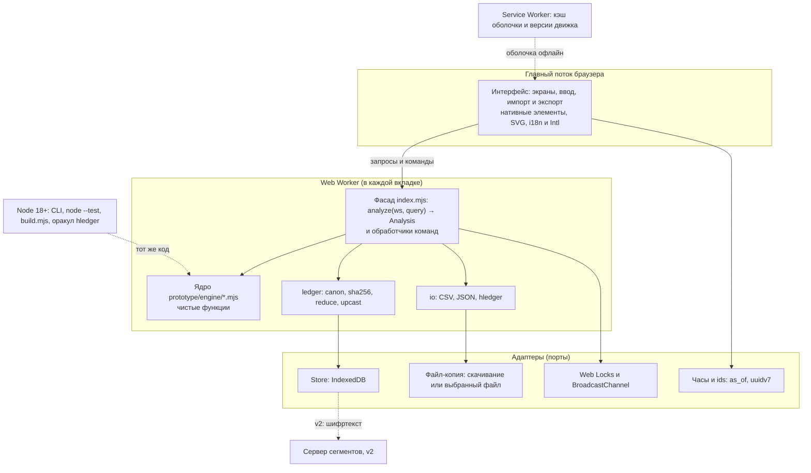
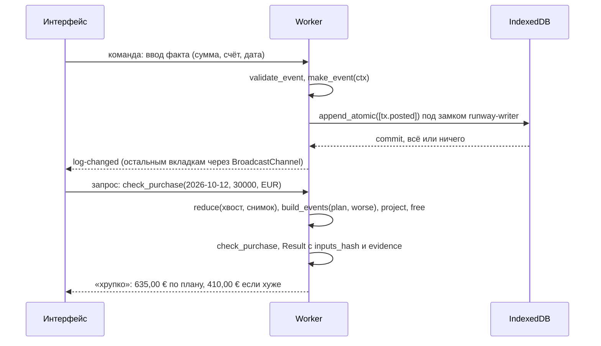

# Архитектура

> Страница описывает, из чего собран Runway v1 и как части взаимодействуют: чистое ядро, журнал, адаптеры хранилища, интерфейс в PWA. Решения — [ADR-001](../decisions/adr-001-core-js-library.md) (форма ядра), [ADR-004](../decisions/adr-004-event-journal-projections.md) (журнал), [ADR-005](../decisions/adr-005-local-first-optional-sync.md) (local-first). Данные — [модель данных](04-data-model.md). Числа примеров — G-001 «Ян» (горизонт 57 дн.). Числовые бюджеты — цели до первого замера (гипотезы), а не обещания. По заявлению автора Budget Guru, его стек — React, Vite, Supabase, Vitest; где живёт расчёт, неизвестно, а политика описывает серверную функцию, получающую «снимок цифр»; офлайн не заявлен ([разбор](../tools/budget-guru.md), не проверено).

Принципы: один код для интерфейса, тестов и ассистента; ядро — чистые функции без часов, сети и случайности; журнал — источник истины; в v1 нет сервера, аккаунтов и LLM; границы защиты пишутся честно.

## Слои и модули



| Слой | Состав | Что запрещено | Где |
|---|---|---|---|
| Интерфейс | экраны, ввод, графики SVG, `Intl` | денежная арифметика, прямой доступ к IndexedDB | `prototype/demo/` в прототипе; каталоги продукта каноном не заданы |
| Фасад и команды | `analyze(ws, query)` → `Analysis` (он же контекст `ctx` для `waves`, `afford`, `tools`, C-012), валидация, `make_event`, кэш по `inputs_hash` | бизнес-правила вне ядра | Worker |
| Ядро | `money` … `verifier` | `Date.now`, `new Date`, `Math.random`, `fetch`, `fs`, `localStorage`, `process.env` (линтер, REQ-007) | `prototype/engine/` |
| Журнал и ввод-вывод | `ledger`, `io` | сеть, файлы: всё внешнее приходит аргументом | там же |
| Адаптеры | Store, файл-копия, замки, часы, ids | бизнес-логика | граница приложения |

Зависимости направлены внутрь: `интерфейс | mcp | cli → адаптеры → ledger → engine` (ADR-001). Слои ADR-001 — это **правило зависимостей**, а не отдельные каталоги: `ledger.mjs` и `io.mjs` лежат в `prototype/engine/` (`ledger` зависит только от `money`); `tsc` проверяет весь `engine/` (C-095, REQ-155). Правило модулей из канона (`A ← B`: B использует A), без циклов:

```pseudo
money ← dates ← { recurrence, hourly, fx, tax, debt, calibration } ← timeline ← sinking ← { waves, afford } ← index (analyze) ← { tools ← verifier, backtest }
ledger ← money;   io ← ledger, dates, money (без timeline: плановые события приходят портом opts.planned)
montecarlo ← timeline, sinking, afford, calibration
```

Это правило из design-brief §14 B4: `calibration` лежит **ниже** `timeline` (`build_events` вызывает `assign_statuses`), а `backtest`, который вызывает `analyze` и `check_purchase`, вынесен в отдельный модуль `backtest.mjs` (из `index` не реэкспортируется, `tools` и `verifier` его не импортируют).

## Потоки команды и запроса

Команда (ввод факта) меняет журнал; запрос (вопрос Q3) только читает его и считает. Оба идут через Worker, поэтому главный поток не блокируется.



Ответ кэшируется по `inputs_hash`: пока журнал окна, версии правил, параметры, `as_of` и `engine_version` те же, ряды `free` не пересчитываются; смена суммы покупки меняет только аргумент `check_purchase`, который работает на готовых рядах за `O(N)`. Любая запись в журнал меняет хэш и сбрасывает кэш: инкрементальных структур нет (C23). Вердикт и числа примера — G-001, покупка 300,00 € на 2026-10-12 при буфере 500,00 €.

## Среды выполнения

| Среда | Что исполняется | API платформы | Фаза |
|---|---|---|---|
| Главный поток | интерфейс; `navigator.storage.persist()` при открытии | DOM, SVG, `Intl` (только здесь) | v1 |
| Web Worker | ядро, журнал, ввод-вывод, Store | IndexedDB, Web Locks, BroadcastChannel | v1 |
| Service Worker | кэш оболочки и версии движка | Cache Storage | v1 |
| Node 18+ | та же библиотека: CLI, `node --test`, `build.mjs`, `prototype/serve.mjs`, оракул hledger | `node:test` | v1 |
| Сервер сегментов | «тупое» хранилище шифртекста: `PUT/GET` сегментов, ≈ 150 строк (IDEA-87); аккаунтов и почты нет | HTTP | v2 |
| MCP-сервер, stdio | реестр инструментов `tools.mjs` с теми же схемами и правами | JSON-RPC | v2 |

В Worker каждой вкладки свой экземпляр ядра; `SharedWorker` не используется: его поддержка в мобильных браузерах в проекте не проверялась (не подтверждено). Нативные клиенты в срез v1 не входят; по оценкам IDEA-82 (субъективным) путь к ним лучше у Rust → WASM (5 из 5 против 3 у JS).

## Хранилище

| Хранилище IndexedDB | Ключ | Содержимое |
|---|---|---|
| `log` | `event_id` (uuidv7) | записи журнала; порядок записей задаёт `seq` (монотонен в рабочей области, обязателен в v1, C-072); индексы по `entity_id`, `type`, `recorded_at`, `seq` |
| `snapshots` | `upto_event_id` | `{state, state_hash, engine_version, v}` каждые ~500 записей; кэш, можно удалить; `state_hash = sha256(canon(state))`, `state` — свёртка `reduce(effective_events(журнал))`, а не лог (C-071) |
| `meta` | строка | `format`, `last_backup_at`, `events_since_backup`, `persisted`, `device_id` (v2) |

Схема хранилища — проектное решение страницы (канон задаёт только «IndexedDB: журнал + снимки»).

```pseudo
append_atomic(evs):                                   # порт Store
  с navigator.locks.request('runway-writer', exclusive):         # один писатель на все вкладки (REQ-122)
    для e в evs: validate_event(e)                    # E_SCHEMA, E_NOT_INTEGER, E_FUTURE_POSTED …
    tx = idb.transaction(['log', 'meta'], 'readwrite')
    для e в evs: tx.log.add(e)                        # add, а не put: повтор event_id не затирает запись
    tx.meta.events_since_backup += len(evs);  await tx.done      # всё или ничего
  channel.post({kind: 'log-changed', last: evs[-1].event_id})    # остальные вкладки читают хвост

boot():
  snap = latest_snapshot();  если snap ≠ null и snap.engine_version ≠ ENGINE_VERSION: drop_snapshots();  snap = null
  state = reduce(read_after(snap?.upto_event_id), base = snap?.state)    # канон v1: reduce(events, base?); отдельной функции fold(снимок, хвост) в v1 нет (§14 N7)
  as_of = локальная дата устройства                    # порт часов; фиксируется в inputs_hash
  баннеры: !persisted → «сделайте файл-копию»;  не PWA → «установка»;  backup_due → напоминание
```

- **Снимки.** Снимок — кэш: любой можно удалить, состояние пересоберётся из журнала. Свёртка снимка с хвостом обязана равняться свёртке всего журнала (REQ-012); запись `revert` в хвосте может ссылаться на запись внутри снимка, поэтому снимок хранит стек версий сущностей (вывод). При смене `engine_version` или схемы состояния снимки сбрасываются.
- **Копия.** Ручной экспорт и автозапись в выбранный файл там, где браузер позволяет; напоминание после `backup.remind_events` = 50 записей или через `backup.remind_days` = 7 дней, что раньше (гипотезы, X10, C-096; настраиваются в `Workspace.params`); баннер, если `persist()` не выдан или приложение не установлено (REQ-097).
- **Удаление.** `eraseAll()` стирает IndexedDB, Cache Storage, регистрацию сервис-воркера, локальные ключи, выдаёт квитанцию со счётчиками (REQ-098, [09](09-import-export.md)).
- **Объём.** ≈ 0,9 МиБ в год при допущении 250 байт на запись; при более чем 10⁵ событий или SQL-аналитике — пересмотр в пользу SQLite-WASM на OPFS ([ADR-004](../decisions/adr-004-event-journal-projections.md)). Safari может удалять скриптовое хранилище после недель без визита (сообщение WebKit; на устройствах не проверялось) — поэтому нужна файл-копия: приложение напоминает о ней, но сохранность данных в браузере не обещает.

## Варианты синхронизации

| Вариант | Приватность | Конфликты | Сложность | Минусы | Решение ADR-005 |
|---|---|---|---|---|---|
| A. Нет синхронизации | максимальная | нет | S | потеря устройства — потеря данных | **v1** (основа) |
| B. Файл-копия, автозапись в выбранный файл | высокая | слияние по `id` | S | ручной ритуал | **v1** вместе с A |
| C. Зашифрованный op-log на «тупом» хранилище | высокая; сервер видит размер и время | объединение по `id`, «последний по (hlc, device)» | M | потеря пароля — потеря облачной копии | **v2** |
| D. CRDT-библиотека через relay | высокая при E2E | встроены | L | зависимость, рост истории (не проверялось) | только для семьи |
| E. Серверная БД с открытыми суммами | низкая: оператор видит всё | решает сервер | S–M | админ-доступ, зависимость от оператора | не строим |

Рекомендация по ADR-005: **v1 = A + B**, v2 = C; облачный ассистент — отдельное согласие и синхронизацию не включает. Что закладывается сейчас: `uuidv7` и `event_id` уникальны без координации, журнал объединяется как множество по `id`, поле `device_id` зарезервировано (v2). План v2: сегменты шифруются на устройстве (AES-GCM, ключ из пароля через PBKDF2-HMAC-SHA256 с числом итераций по рекомендации OWASP, либо Argon2id), ключ восстановления показывается при включении; для порядка нужны `hlc` и `device_id` (v2; апкастер добавит значения по умолчанию), а `seq` обязателен уже в v1 (раздел 3.3 канона, C-072). Значения `kdf.iterations` и `kdf.wrap` определит ADR до v2 (в `vocab.json` ключи зарезервированы; на 2026-10-04 значения не перепроверены, C-081). Для сравнения: [Actual Budget](../tools/actual-budget.md) хранит данные локально и синхронизирует через сервер (Docker), E2E включается отдельно, а секреты банковской синхронизации лежат на сервере вне E2E.

## Сборка и инструменты

| Инструмент | Назначение | Правило |
|---|---|---|
| `node --test` и генератор журналов с seed | golden, property, фаззинг, оракул | встроенный раннер, сторонних библиотек нет ([ADR-014](../decisions/adr-014-testing-approach.md)) |
| `tsc --noEmit --checkJs` | проверка JSDoc-типов в CI на каталоге `engine/` (C-095) | не шаг сборки (REQ-155) |
| линтер чистоты `engine/` | запрет `Date.now`, `Math.random`, `fetch`, `fs` … | блокирует сборку; TST-60 |
| линтеры словаря и обещаний | слова вне `vocab.json`, запрещённые формулировки, метка «гипотеза» старше 90 дней | блокируют сборку (REQ-114, REQ-178) |
| `node build.mjs` | релиз: файлы и манифест SHA-256 | двойная сборка даёт тот же манифест: пути отсортированы, меток времени нет; хэш сборки виден в «О программе» (REQ-154, TST-60) |
| `arith.lock` | 500 журналов, seed 2026 | побайтное равенство; правка арифметики — отдельный коммит ARITH-CHANGE |
| `hledger` (опционально) | оракул: `hledger bal assets:bank --forecast=2026-10-04..2026-11-30 -e 2026-11-01` обязан совпасть с `close` движка на 2026-10-31 (без `--forecast` правила `~` не включаются; интервал начинается с `as_of`; синтаксис запуском не проверен, C-042) | включается в CI при наличии, TST-44 |
| подсчёт зависимостей | ядро — 0, интерфейс — не более 3, каждая по ADR | четвёртая блокирует сборку (REQ-156, TST-60) |

Подписанные релизы через Service Worker не делаем (C22): проверку выполняет новый воркер, то есть возможно скомпрометированный код. Вместо этого — воспроизводимая сборка и опубликованные хэши; при первой загрузке пользователь доверяет хосту, это пишется в документации.

**Обновление оболочки** (проектное решение страницы). После первой загрузки оболочки основные сценарии работают без сети; сеть нужна только для проверки обновления на собственном хосте (REQ-120, C-062). Новая версия оболочки ставится в состояние ожидания и включается при следующем запуске; данные на диске при этом не переписываются: версию формата обрабатывают апкастеры, а запись более новой версии открывается только для чтения. Хэш сборки в «О программе» позволяет сверить установленную версию с опубликованным манифестом.

## Границы доверия

| Граница | Мера | Требование |
|---|---|---|
| Приложение ↔ сеть | политика содержимого `connect-src 'self'`; в `engine/` нет `fetch`; сумм, дат и описаний наружу не отправляется | REQ-120, REQ-121; TST-59 |
| Страница ↔ сторонний код | `script-src 'self'`, без inline-скриптов, внешних шрифтов и аналитики, без платёжных SDK | REQ-123; TST-59 |
| Хранилище и файл-копия ↔ посторонний доступ к устройству | в v1 данные на устройстве и файл-копия **не шифруются**; остаточный риск описывается пользователю явно; защищённый паролем экспорт — v1.1 на том же WebCrypto-коде, что v2 | REQ-125, C-081 |
| Файл импорта ↔ приложение | размер ≤ 5 МБ до разбора, разбор в Worker, профиль — данные без исполняемых полей; описания операций — недоверенный текст | REQ-091, [ADR-013](../decisions/adr-013-prompt-injection-policy.md) |
| Журнал ↔ логи | белый список полей `id`, `n`, `ms`, `code`, `engine_version`; суммы и описания в логи не попадают | REQ-124 |
| Экспорт CSV ↔ таблица | ведущие `=`, `+`, `-`, `@`, TAB, CR экранируются только в текстовых колонках, числовые не меняются; профиль `runway-csv/1` при импорте снимает экранирование (только для экспорта самого Runway, C-045) | REQ-095, X5 |
| Ассистент ↔ данные | в v1 только `A0`: числа подставляет рендерер из `evidence`, сетевых и удаляющих инструментов нет | [ADR-010](../decisions/adr-010-ai-tools-and-number-verifier.md) |

Остаточные риски (потеря устройства без копии, расширения браузера с доступом к странице) пишутся пользователю в отчёте «где что лежит» (REQ-125) и в модели угроз (REQ-126).

## Бюджет производительности

Расчёт целиком, без инкрементальных структур (C23, REQ-151). Для G-001 `N = 58` дней и `M = 16` плановых событий, `N·M = 928`; целевой масштаб `180 × 10³ = 180 000` больше примерно в 194 раза.

| Метрика | Бюджет (гипотеза) | Как измеряется |
|---|---|---|
| Полный пересчёт: развёртка, проекция, волны, Q3; N = 10³ событий, H = 180 | p95 ≤ 100 мс на среднем телефоне | TST-54, публикуются p50 и p95 (REQ-150) |
| Блокировка главного потока | ≤ 50 мс: расчёт идёт в Worker | замер длинных задач |
| Рост времени | при удвоении N — не более ×2,5 | 10³, 2·10³, 4·10³ событий (REQ-151) |
| Холодный старт офлайн до «Обзора» | ≤ 2 с | три устройства, с `n` и датой (REQ-152) |
| Открытие журнала в 36 500 записей | ≤ 2 с | REQ-153 |
| Размер записи | ≈ 250 байт, отклонение не более 50 % | фактический замер |
| Сеть после загрузки оболочки | 0 запросов | журнал сетевых запросов (REQ-120) |

| Операция | Сложность | Источник |
|---|---|---|
| `project`, `answer_q1` | `O(N + M)` | [ALG-02](../algorithms/alg-02-timeline-projection.md) |
| `detect_waves` | `O(M log M)` | [ALG-03](../algorithms/alg-03-payment-waves-detection.md) |
| `check_purchase` (на режим), `suffix_min` | `O(N + P + E)`, `O(N)` один раз; `max_amount` — `O(1)` | [ALG-04](../algorithms/alg-04-can-i-afford.md) |
| `reserve_series` | `O(N·R + E + A)` | [ALG-11](../algorithms/alg-11-safe-to-spend.md) |
| импорт CSV | разбор `O(L)`, ключи `O(R)`, двойники `O(R log E)` | [ALG-14](../algorithms/alg-14-hledger-export-csv-import.md) |

Монте-Карло (v2, `n_paths = 2000`) в бюджет v1 не входит: оценка — порядка 10⁶–10⁷ операций, десятки миллисекунд (вывод, до замера). Размер оболочки каноном не задан: измеряется при первой сборке.

## Режимы отказа

| Отказ | Как обнаруживается | Поведение |
|---|---|---|
| Хранилище не закреплено или приложение не установлено | результат `persist()`, режим отображения | работа продолжается; баннер «сделайте файл-копию» (REQ-122) |
| Браузер очистил данные | пустая база при запуске | первый экран предлагает «Восстановить из файла-копии»; `state_hash` совпадает с копией (REQ-122) |
| IndexedDB недоступна, квота, ошибка записи | исключение в транзакции | транзакция откатывается целиком, молчаливых потерь нет; код ошибки и предложение экспортировать файл |
| Две вкладки пишут одновременно | Web Locks | записи под эксклюзивным замком; в тесте 2 × 1000 записей дают 2000 без потерь и дублей |
| Запись с неизвестной более новой `v` | `upcast` | запись и файл только для чтения, диск не меняется (REQ-016) |
| Невалидные данные: float, будущий факт, нет курса | валидатор записи | отказ кодом (`E_NOT_INTEGER`, `E_FUTURE_POSTED`, `E_NO_RATE`); число не показывается |
| Исключение внутри движка | фаззинг 10⁵ журналов | не допускается: на любом входе результат или код (REQ-158) |
| Сменилась `engine_version` | версия в снимке | снимки сбрасываются и пересобираются из журнала |
| Остаток давно не сверялся | `age > 7` / `age > 21` дней по самому несвежему `operating`-счёту (D-22); у счёта без якоря возраст неизвестен — `block`, причина `no_anchor` (C-010) | плашка «не учтено ≈ …»; вердикт Q3 и «можно потратить» заменяются «данных мало» (`gate`); Q1 и волны не блокируются |
| Буфер не задан или есть правило в статусе `disabled` | `gate`: `no_buffer`, `rule_disabled` (C-018, C-024) | Q3 и «можно потратить» отвечают `insufficient_data`; Q1 и волны считают `B = 0` с `W_BUFFER_UNSET`; расчёт `free` с правилом `disabled` продолжается, показ зависящих чисел заменён текстом «правило не подтверждено с <даты>» |
| Курс старше `fx.stale_days` = 30 (X11) | дата курса | плашка свежести, расчёт не блокируется |
| Неверная дата устройства | `as_of` из часов | расчёт воспроизводим, но неверен; `as_of` всегда виден, будущий факт — `E_FUTURE_POSTED` |
| Нет прав на выбранный файл-копию | ошибка записи файла | возврат к ручному скачиванию и напоминанию |
| Потеря устройства без копии | — | данные потеряны; это написано в отчёте «где что лежит» (REQ-125) |

## Соответствие модулям prototype/engine

Прототип реализует все модули (включая v2) с тестами: 19 файлов `.mjs` в `prototype/engine/` (17 модулей из таблицы ниже плюс `backtest.mjs` и фасад `index.mjs`) и `vocab.json`; итоги прогона — [находки прототипа](16-prototype-findings.md). Порты — только аргументы функций.

| Модуль | Роль в архитектуре | Порты (аргументы) | ALG | v1 |
|---|---|---|---|---|
| `money.mjs` | целые деньги, округление, разбор/формат без `Intl` | — | вспом. | да |
| `dates.mjs` | гражданские даты, календари | календарь пользователя | ALG-01 | да |
| `recurrence.mjs` | развёртка правил в вхождения | календари, `Override` | ALG-01 | да |
| `timeline.mjs` | слои → ряды `close`/`trough`, Q1, сценарии (в том числе `purchase_to_events`, C-008), «почему», `outflow_90`/`buffer_hint`/`default_wave_threshold` | `as_of`, `horizon_end` | ALG-02 | да |
| `waves.mjs` | волны и метрики | параметры, ряды | ALG-03 | да |
| `afford.mjs` | Q3 и safe-to-spend | ряд `free`, буфер | ALG-04, 11 | да |
| `sinking.mjs` | sinking, ряд резервов | резервы, аллокации | ALG-05, 11 | да |
| `tax.mjs` | налоговый конверт | версии правил | ALG-06 | `percent_of_income` |
| `hourly.mjs` | ставка × часы | календарь | ALG-07 | да |
| `fx.mjs` | курсы, валюта решения | курсы | ALG-08 | `spot` |
| `debt.mjs` | аннуитет, рассрочка | — | ALG-09 | частично |
| `montecarlo.mjs` | seeded Монте-Карло | `seed` | ALG-10 | нет |
| `calibration.mjs` | сопоставление план↔факт, статусы вхождений, свежесть якоря; v2 и прототип — лаги, `shrink_to_prior`, `wilson` (backtest здесь нет, §14 B4) | параметры | ALG-13 | сопоставление и статусы; остальное — нет |
| `backtest.mjs` | обратная проверка плана на журнале, `release_gate`, `default_breach`; зависит от `index`, `afford`, `ledger`, `calibration` | журнал, окно, `opts.band` | ALG-13 | гейт релиза — v1 (REQ-176, C-082); интерфейс backtest — v2 |
| `tools.mjs`, `verifier.mjs` | реестр инструментов, рендер и верификатор чисел | контекст состояния | ALG-12 | реестр, рендер |
| `ledger.mjs` | журнал, `canon`, SHA-256, `reduce`, `effective_events`, дедупликация, `state_at` (единственная реализация, C-056) | ids, `seq` и `recorded_at` через `ctx` | — | да |
| `io.mjs` | CSV, JSON, hledger | текст файла, уже декодированный | ALG-14 | да |
| `vocab.json`, `index.mjs` | словарь и пороги; фасад `analyze` | — | — | да |

## Технологические выборы

| Слой | Выбор v1 | Альтернативы | Обоснование | Пересмотр |
|---|---|---|---|---|
| Ядро | JavaScript, ES-модули, JSDoc | TypeScript, Rust → WASM, Python на сервере | один код в Worker, Node и тестах; нулевая цепочка поставки; экспертные оценки 97 / 86 / 77 / 57 из 105 (субъективны) | Rust → WASM, если Монте-Карло не уложится в бюджет |
| Деньги | целые + BigInt при умножении | float, decimal-библиотека | [ADR-002](../decisions/adr-002-money-minor-units.md) | — |
| Хэш | чистый SHA-256 в `ledger.mjs` | `node:crypto` | одинаково в Worker и Node, без зависимостей | WebCrypto для шифрования v2 |
| Интерфейс | нативные элементы, Web Components, SVG; ≤ 3 сторонних зависимостей по ADR | Preact-класс, Svelte, React (у Budget Guru по словам автора) | воспроизводимая сборка, размер PWA | рост числа экранов |
| Графики | SVG вручную + таблица значений | uPlot-, Chart.js-, D3-класс | доступность (REQ-166), ноль зависимостей | сложные типы графиков |
| Хранилище | IndexedDB: журнал и снимки | SQLite-WASM на OPFS, файл-журнал | работает офлайн без особых заголовков | более 10⁵ событий |
| Офлайн | PWA и Service Worker | нативное приложение | один код, установка с домашнего экрана | — |
| Синхронизация | нет; файл-копия | серверная БД | [ADR-005](../decisions/adr-005-local-first-optional-sync.md) | v2: op-log |
| Тесты | `node --test`, свой генератор | сторонняя property-библиотека | [ADR-014](../decisions/adr-014-testing-approach.md) | — |
| Доставка | статический хостинг; локально XAMPP или `serve.mjs` | сервер приложений | в v1 нет серверной логики (REQ-121) | v2: сервер сегментов |

### Не в v1

Сервер сегментов и E2E-синхронизация (v2); MCP-сервер и режимы ассистента `A1`–`A3` (v2); SQLite-WASM при росте журнала; Rust → WASM при нехватке бюджета Монте-Карло; семейный режим (v2, отдельный ADR); подписанные релизы — отвергнуты.

## Связанные страницы

- [Модель данных](04-data-model.md), [Импорт и экспорт](09-import-export.md), [Требования](02-requirements.md), [Видение](00-vision.md)
- Решения: [ADR-001 ядро](../decisions/adr-001-core-js-library.md), [ADR-004 журнал](../decisions/adr-004-event-journal-projections.md), [ADR-005 local-first](../decisions/adr-005-local-first-optional-sync.md), [ADR-014 тестирование](../decisions/adr-014-testing-approach.md)
- [Local-first и приватность](../concepts/local-first-privacy.md), [ALG-02](../algorithms/alg-02-timeline-projection.md)
- [Budget Guru](../tools/budget-guru.md), [Actual Budget](../tools/actual-budget.md)
