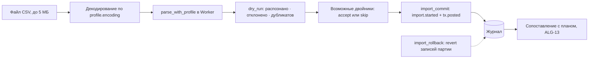

# Импорт и экспорт

> Ручной ввод — осознанный выбор целевого пользователя (счета в ЕС, наличные, крипта), поэтому ввод быстрый, импорт воспроизводим и обратим, а выход — без боли. Решение — [ADR-011](../decisions/adr-011-manual-entry-csv-hledger-import.md); псевдокод, ключи и векторы — [ALG-14](../algorithms/alg-14-hledger-export-csv-import.md). Страница описывает продуктовый уровень: что видит пользователь, какие форматы и гарантии. Числа — сквозной набор G-001 «Ян» (`as_of` 2026-10-04, **горизонт 57 дн.**) и независимые векторы канона. У Budget Guru импорт заявлен «пока только руками» (так сказано в FAQ), экспорт и удаление — по запросу, кнопки удаления нет по тексту политики; в приложении это не проверялось, self-service экспорт тоже (не подтверждено; [разбор](../tools/budget-guru.md)). Налоговые числа в экспорте — расчёт по введённым правилам, не консультация.

Принципы: каждый импорт воспроизводим (тот же файл — те же записи, повторный — ноль новых) и обратим (откат партии); профиль разбора — данные, а не код; деньги разбираются строками без float; банковских агрегаторов в ядре нет.

## Конвейер импорта



Импорт создаёт только факты (`posted`); связь с плановыми платежами — отдельный шаг сопоставления ([ALG-13](../algorithms/alg-13-plan-vs-actual-calibration.md)), журнал фактов он не меняет: ручная привязка факта к плану и пометка «не относится к плану» — отдельные записи журнала `match.set` (`reduce` проставляет `plan_ref`/`no_plan` в проекции факта; C-051). Сигнатуры: `parse_with_profile(profile, text, ctx)` с `ctx = {account_id, account_currency, as_of}` → `{candidates, rejects, rows_total}`; `dry_run(candidates, existing_keys, rejects, existing_events, params)` → `{recognized, rejected, duplicates, rows_total, doubles, from, to, overlap_days, gap_days}`; `import_commit`, `import_rollback(batch_id, events)` (C-043).

## Форматы

| Формат | Направление | Фаза | Что несёт | Потери и замечания |
|---|---|---|---|---|
| JSON `runway-journal/1` | экспорт и импорт | v1 | полный журнал по порядку `seq`: все сущности и версия формата | без потерь: `state_hash(import(export(s))) = state_hash(s)` (TST-38), где `state_hash(state) = sha256(canon(state))`, `state` — свёртка эффективных записей, `recorded_at` в неё не входит (C-071); читается без приложения |
| CSV журнала `runway-csv/1` | экспорт; импорт встроенным профилем | v1 | факты и планы плоским списком (разделитель `,`, перевод строки LF): `date`, `account_id`, `amount_minor`, `currency`, `kind`, `layer`, `tag`, `counterparty`, `note`, `event_id`, `dedup_key` (C-045) | правил, потоков, резервов и сценариев нет; текстовые ячейки экранируются |
| CSV выписки банка | импорт по `ImportProfile` | v1 | факты `tx.posted` | одна валюта счёта; файл ≤ 5 МБ |
| hledger `.journal` | экспорт | v1 | факты, якоря как assertions, планы как `~ ДАТА`, курсы `P` | налоги, часы, сценарии, коридоры — только материализованными событиями |
| hledger `.journal` | импорт подмножества | v1.1 | `~` → `Rule`, `=` → `Anchor`, `P` → `FxRate`, `@`/`@@` → курс операции | проводки с более чем двумя ногами сворачиваются в «откуда → куда» с явной строкой «неразнесённое» |
| `.xlsx` и CSV из таблиц, мастер | импорт | v1.1 | классы листов | в v1 — профиль CSV и шаблон |
| Дзен-мани, CoinKeeper, OFX | импорт | v2 | см. ниже | REQ-101 |

Кодировка по умолчанию UTF-8, BOM снимается, остальные кодировки задаёт поле `encoding` профиля.

## Мастер маппинга CSV

Профиль `ImportProfile` — JSON-данные: исполняемых полей нет, неизвестное поле отвергается (`E_SCHEMA`). Мастер ведёт пользователя по шагам; на любом шаге журнал не меняется до подтверждения.

| № | Шаг | Что решает пользователь | Что делает система |
|---|---|---|---|
| 1 | Счёт назначения | счёт; его валюта фиксируется | строки другой валюты получат `currency_mismatch` (две ноги — v1.1) |
| 2 | Файл | выбирает файл | размер ≤ 5 МБ проверяется до разбора; разбор в Worker, файл не покидает устройство |
| 3 | Профиль | берёт сохранённый или создаёт новый | по заголовкам предлагает черновик; пользователь подтверждает (IDEA-84) |
| 4 | Формат файла | кодировка, разделитель, `skip` — число строк преамбулы | заголовок обязателен: это следующая за преамбулой строка (C-044) |
| 5 | Дата | колонка и формат (`DD/MM/YYYY`) | несуществующая дата (`31/02/2026`) → `bad_date` |
| 6 | Сумма | `signed` (одна колонка) или `debit_credit`; десятичный знак, разделитель тысяч | `parse_minor` даёт целое; «12,345» при двух знаках отклоняется, а не округляется |
| 7 | Валюта | фиксированная или колонка | код проверяется по реестру |
| 8 | Описание | колонки `desc.cols` | значения склеиваются; описание — недоверенный текст, в журнал идёт как `note` |
| 9 | Метки | правила `{match, tag}` | литеральное совпадение по `norm(desc)`: префикс при ведущем `^`, иначе подстрока; regex нет (профиль — данные, не должен вешать разбор, ReDoS; C-044) |
| 10 | Предпросмотр | сверяет знак и дату на начальных строках | показывает разобранные значения |
| 11 | Сухой прогон | смотрит отчёт | «распознано · отклонено · дубликатов», `rows_total`, период, `overlap_days`, `gap_days` |
| 12 | Двойники | `accept` или `skip` для каждого | без решения — `skip` |
| 13 | Подтверждение | подтверждает | `import_commit`: `import.started` и `tx.posted` одной атомарной записью |
| 14 | Итог | сохраняет профиль (запись `profile.set`, C-069); может откатить партию | `import_rollback`: `revert` каждой записи партии (отдельного `tx.voided` нет, C-070) |

Профиль для банковской выписки с разделителем `;` и колонками дебета и кредита (G-001 не содержит выписок: пример — вектор TV-2 из ALG-14):

```json
{"profile_id":"bank-x-semicolon","v":1,"encoding":"utf-8","delimiter":";","skip":0,
 "date":{"col":"Fecha","fmt":"DD/MM/YYYY"},
 "amount":{"mode":"debit_credit","debit":"Cargo","credit":"Abono","decimal":",","thousands":"."},
 "currency":{"fixed":"EUR"},"desc":{"cols":["Concepto"]},"rules":[{"match":"^MERCADONA","tag":"продукты"}]}
```

Сухой прогон на шести строках файла при `as_of` 2026-10-04 (ключи `f78f…` и `9d82…` уже есть в журнале):

| Строка файла | Разбор | Итог |
|---|---|---|
| `03/10/2026;MERCADONA  *1234 Valencia, ES;47,30;` | −4730, `k = 0` | дубликат |
| `03/10/2026;Cafe Central;4,50;` | −450, `k = 0` | дубликат |
| `03/10/2026;Cafe Central;4,50;` | −450, `k = 1` | распознано |
| `04/10/2026;Transferencia cliente;;1.234,56` | `parse_minor('1.234,56')` = +123456 | распознано |
| `31/02/2026;Error fecha;10,00;` | дата не существует | отклонено: `bad_date` |
| `01/10/2026;Doble columna;5,00;5,00` | заполнены обе колонки | отклонено: `both_debit_credit` |

Итог: распознано 2 · отклонено 2 · дубликатов 2; 2 + 2 + 2 = 6 строк; сумма распознанных −450 + 123456 = 123006. После записи повторный импорт того же файла даёт распознано 0, дубликатов 4, отклонено 2.

Причины отклонения (`reason`): `short_row` (строка короче нужного), `bad_date`, `future_date` (позже `as_of`), `unknown_currency`, `currency_mismatch`, `bad_amount` (пусто, мусор или знаков больше `exponent`), `empty_amount`, `both_debit_credit`, `sign_in_debit_credit` (знак внутри колонки дебета/кредита), `zero_amount`; для встроенного профиля `runway-csv/1` — `filtered_out` (строки планов отсеиваются фильтром). Файл больше 5 МБ и незакрытая кавычка — `E_SCHEMA` до записи, ничего не импортируется.

## Дедупликация

Ключ идемпотентности и «возможный двойник» описаны в [ALG-14](../algorithms/alg-14-hledger-export-csv-import.md); здесь — как это выглядит для пользователя.

```pseudo
dedup_key = hex(sha256(acc|date|amount_minor|currency|norm(desc)|k))[0:16]
# norm: NFKC → нижний регистр → не-буквы и не-цифры → один пробел → trim
# k — номер среди одинаковых (дата, сумма, валюта, norm(desc)) в партии
```

Векторы (счёт `acc_bank`, 2026-10-03, EUR): `MERCADONA  *1234 Valencia, ES`, −4730, `k = 0` → `f78f01e9751c5f66` (прообраз с `norm` = `mercadona 1234 valencia es`); «Cafe Central» −450: `k = 0` → `9d82db80ee854a7c`, `k = 1` → `b9f6b8bb563b3b40`. Коллизия 64-битного ключа при 10⁵ записей ≈ 3·10⁻¹⁰. Идентификатор банка (`FITID`, OFX — v2) будет приоритетнее хэша: в v1 у CSV надёжного идентификатора нет, колонки внешнего идентификатора в профиле тоже (id можно подмешать в `desc.cols`; C-044).

| Ситуация | Что происходит | Результат |
|---|---|---|
| Тот же файл второй раз | все ключи уже есть | `duplicates = rows`, плашка «файл уже импортирован» (по `source_hash`) |
| Пересекающиеся выписки | общие дни дают те же ключи | дубликаты только на пересечении; в отчёте `overlap_days` |
| Два одинаковых платежа за день | `k = 0` и `k = 1` | записываются оба, ключи различны |
| Банк сменил описание | другой ключ, но та же сумма в окне ±3 дня | «возможный двойник» в очереди, без молчаливого слияния |
| Ручная запись и импорт | у ручной нет `dedup_key` | двойник по сумме и окну: решает пользователь (TV-3) |
| Откат партии | `revert` всех её записей | ключи откатанных записей не считаются существующими |
| Окно выписки режет день посередине (во втором файле видна только одна из двух одинаковых операций, `k = 0`) | вторая из одинаковых операций в другом файле принимается за дубликат первой | известное ограничение `k`: честная граница, не скрывается (C-047; [RISK-17](12-risks.md)) |

После импорта факты сопоставляются с планом (окно 3 дня, допуск 500 bp, автосопоставление только при единственном кандидате): план аренды −90000 на 2026-11-25 и факт −90000 на 11-27 → `matched`; факт −94500 → `matched`; −95000 → «возможный двойник» (в очередь); −100000 → не сопоставлен.

## Экспорт

**JSON** — полное состояние с `format: runway-journal/1`; импорт обратно без потерь. **CSV журнала** — для таблиц: числовые колонки (`amount_minor`, даты) пишутся каноническим числом, в текстовых колонках (описание, заметка, метка, контрагент) ячейки, начинающиеся с `=`, `+`, `-`, `@`, TAB или CR, получают префикс `'`; иначе отрицательная сумма `-4730` была бы испорчена (X5). Пример: `=HYPERLINK("http://x")` → `'=HYPERLINK("http://x")`; встроенный профиль `runway-csv/1` при импорте снимает ведущий `'` перед одним из `= + - @ TAB CR` (только для экспорта самого Runway; C-045).

### Таблица соответствий: hledger

| Runway | hledger |
|---|---|
| факт `tx.posted` | транзакция `ДАТА * описание` из двух проводок: `assets:<счёт>` и `income:<метка>` или `expenses:<метка>` (`unsorted`, если метки нет) |
| перевод между счетами | одна транзакция с двумя ногами; разные валюты — запись `@@` |
| якорь `anchor.set` | транзакция `delta = A − баланс журнала` с assertion `= A` и противосчётом `equity:opening` (первая запись счёта) или `equity:drift` — assertion остаётся истинной, дрейф виден (D-22); `history: from_anchor` (по умолчанию) опускает проводки до последнего якоря (C-046) |
| план: правила, потоки, график долга | разовые правила `~ ДАТА` по каждому вхождению в `[as_of, horizon_end]` (режим `plan`, статусы `expected`, `overdue`) |
| простое ежемесячное правило | возможна одна строка `~ monthly …` (`interval = 1`, день ≤ 28, `weekend = keep`, без исключений; не проверено на hledger) |
| `FxRate` | директива `P ДАТА base курс quote` |
| валюта | `commodity 1000.00 EUR` |
| счёт `debt` | `liabilities:`; прочие — `assets:` |
| `TaxRule`, `Reserve`, `IncomeStream`, `Scenario`, `WaveOverride` | как сущности не экспортируются: их эффект — плановые события — материализован; сами сущности — только в JSON |
| описание | управляющие символы и `;` заменяются пробелом (`;` начинает комментарий), не более 200 символов |

Перед экспортом приложение показывает список потерь: что hledger выразить не может и что выгружено материализованными событиями. Фрагмент для G-001 (счёт `bank`, якорь 400000 на 2026-10-04; всего 16 разовых правил: 8 продуктов, 2 связи, 2 аренды, 2 ЖКХ, налог, доход):

```text
; runway-journal/1 · as_of 2026-10-04 · horizon_end 2026-11-30
commodity 1000.00 EUR

2026-10-04 * якорь
    assets:bank  4000.00 EUR = 4000.00 EUR
    equity:opening  -4000.00 EUR

~ 2026-10-09  связь
    assets:bank  -25.00 EUR
    expenses:phone  25.00 EUR
```

Экспорт служит независимым оракулом движка (идея, на hledger в проекте не запускалось): `hledger bal assets:bank --forecast=2026-10-04..2026-11-30 -e 2026-11-01` обязан дать `4000 − (25 + 100 + 100 + 500 + 100 + 900 + 120 + 100) = 2055,00 €` = `close[2026-10-31]` = 205500; с `-e 2026-12-01` — 3400,00 € = `end_close` 340000. Без `--forecast` правила `~` не включаются; интервал начинается с `as_of`, иначе планы на `as_of` теряются; синтаксис периода запуском не проверен (метка остаётся, C-042). Расхождение — ошибка либо экспорта, либо движка (TST-44).

## Миграция из Excel и Google Sheets

Таблицы — «нулевой уровень» кэшфлоу-планирования: баланс периода равен предыдущему плюс приходы минус расходы, всё руками; шаблона «покупка на дату» нет, формулы хрупки ([таблицы](../tools/spreadsheets.md)). Runway не просит доступа к Google Drive: пользователь скачивает файл сам (CSV или XLSX; список форматов экспорта Sheets в справке не приведён, по вторичным источникам это XLSX, CSV, ODS). Импортируются значения, не формулы.

| Структура в таблице | Сущность Runway | Правило импорта | v1 | Мастер (v1.1) |
|---|---|---|---|---|
| Журнал (Date, Description, Amount, Account, Transaction ID) | `tx.posted` | знак по колонке суммы или по Debit/Credit; ключ — `dedup_key` | профиль CSV | класс `journal` |
| Balance History | якоря `anchor.set` | последний остаток — якорь, расхождение — `drift` | вручную одним полем | авто |
| Список bills (имя, сумма, день, частота) | `Rule` | предупреждение о 31-м числе (`clamp`); частота → `freq` и `interval` | вручную по шаблону | класс `bills` |
| Сетка 13-week (статьи × недели) | плановые события | un-pivot; дата — неделя, пометка точности даты (`date_precision` зарезервировано для v1.1, C-096) | — | `grid_weeks` |
| Категория × месяц | — | только как план; бюджета по категориям в v1 нет | не импортируется | `category_by_month` |
| Лист sinking funds (цель, дата, накоплено) | `Reserve` (`sinking`) | `target_minor`, `due_date`, `funded_start_minor`; взнос пересчитывается | вручную | `sinking` |
| Income Log (invoiced, received) | ожидаемые поступления | разность дат — наблюдаемая задержка оплаты | вручную | `income_log` |

Класс `unknown` получает вопрос пользователю, а не молчаливый импорт. Путь в v1:

1. Лист скачивается как CSV (по файлу на лист); проверяются формат дат и десятичный знак.
2. Создаётся профиль (шаг 3 мастера). Для выгрузки Tiller колонки `Date`, `Description`, `Amount` (приход +, расход −) отображаются на `date`, `desc.cols` и режим `signed`; `Account` задаётся шагом 1. Колонка `Transaction ID` в профиле v1 не поддерживается (внешнего идентификатора в `ImportProfile` нет): её можно добавить в `desc.cols`, тогда она войдёт в ключ.
3. Сухой прогон; пример из канона: лист из 1 842 строк → 1 811 импортировано, 23 дубликата, 8 пропущено (нет даты), 1 811 + 23 + 8 = 1 842.
4. Вводится якорь по последнему остатку из листа; расхождение с суммой фактов показывается как `drift`, а не скрывается.
5. Повторяющиеся платежи и поступления вводятся правилами; в v1.1 это делает мастер.
6. `close` на одну дату сверяется с остатком таблицы.

## Дзен-мани и CoinKeeper (v2, только подтверждённое)

| Аспект | Дзен-мани | CoinKeeper |
|---|---|---|
| Программный доступ | официальный API: OAuth 2.0, регистрация приложения, токен пользователя | в изученных материалах не найден (2026-10-04) |
| CSV-экспорт | подтверждён только материалом 2021 года; колонки в проекте не зафиксированы (не подтверждено) | CSV на тарифе Platinum заявлен; колонки не проверялись (не подтверждено) |
| Модель данных (по wiki API) | `Account` (cash, ccard, checking, loan, deposit, emoney, debt), `Instrument`, `Transaction` (суммы и валюта обеих сторон), `Tag`, `Merchant`, `Budget`, `Reminder`, `ReminderMarker` | не изучалась |
| Синхронизация | diff по метке `changed`, побеждает более новая версия, удалённое — списком `deletion` | — |
| Сторонние клиенты на API | Budgera, DzenAnalytics (MIT, локально в браузере), `zenmoney-api` | — |

Источник — [страница инструмента](../tools/zenmoney-coinkeeper.md) (статус `reviewed`: часть утверждений не подтверждена). Budget Guru импорт из Дзен-мани не поддерживает (заявлено в FAQ, не проверено). План адаптера (v2; сопоставление по документации API, на реальных данных не проверено):

| Дзен-мани | Runway |
|---|---|
| `Reminder{interval, step, points, startDate, endDate}` | `Rule`: `interval` (day, week, month, year) → `freq` D, W, M, Y; `step` → `interval`; даты → `start_date`, `until_date`; смысл `points` уточняется по фикстуре |
| `ReminderMarker` planned, processed, deleted | вхождения `expected`, `matched`, `skipped` |
| `Transaction` | `tx.posted`; суммы обеих сторон в разных валютах → две ноги и выведенный курс |
| `Account` cash, checking, ccard, deposit, loan, debt | классы «деньги / накопления / долг» → `liquidity`: `operating`, `savings`, `debt`; `emoney` — по подтверждению пользователя |
| `Budget` | не переносится: бюджета по категориям в v1 нет |
| `Tag`, `Merchant` | `tag`, контрагент — как недоверенный текст |

OAuth с регистрацией приложения тяжёл для обычного пользователя, поэтому запасной путь — профиль CSV по фикстуре настоящего экспорта; адаптеры проходят тот же сухой прогон и дедупликацию. В v1 пользователь с CSV-файлом из этих приложений может описать колонки собственным профилем: готового профиля нет.

## Гарантия переносимости

| Гарантия | Как обеспечивается | Как проверяется |
|---|---|---|
| Полный экспорт читается обратно без потерь | JSON `runway-journal/N`, апкастеры | `state_hash` на 10³ случайных журналов; экспорт G-001 после импорта сохраняет `opening` 400000 и `end_close` 340000 (REQ-094, TST-38) |
| Формат опубликован | спецификация, фикстуры каждой версии, таблица апкастеров | импорт фикстуры даёт заявленный `state_hash` (REQ-187) |
| Данные читаются без приложения | JSON, CSV, hledger — открытые форматы | REQ-186 |
| Независимая проверка | hledger как оракул | `hledger bal` = `close` движка (TST-44) |
| Формулы в ячейках не исполняются таблицей | экранирование ведущих `=`, `+`, `-`, `@`, TAB, CR только в текстовых колонках | REQ-095 |

Гарантия относится к JSON; CSV и hledger несут подмножество (правил, резервов, потоков, сценариев в них нет). Незашифрованная копия — риск утечки при потере файла (IDEA-56): в v1 хранилище и файл-копия не шифруются, остаточный риск описывается пользователю явно; защищённый паролем экспорт — v1.1 на том же WebCrypto-коде, что v2 (C-081). Деньги экспортируются десятичными строками из минорных единиц без потерь.

| Продукт | Экспорт и удаление (по страницам `tools/`) |
|---|---|
| [Firefly III](../tools/firefly-iii.md) | экспорт CSV нельзя импортировать обратно; бэкап — только дамп БД |
| [YNAB](../tools/ynab.md) | два CSV (план и реестр), только из веба |
| [Actual Budget](../tools/actual-budget.md) | локальный файл и API-функции `importBudget`/`exportBudget` (26.8.0); экспорт транзакций в CSV из docs не подтверждён |
| [hledger](../tools/plain-text-accounting.md) | CSV, JSON, HTML без lock-in; импорт полуручной |
| [Budget Guru](../tools/budget-guru.md) | копия и удаление «по запросу», обычно до 72 ч; кнопки удаления нет по тексту политики (заявлено, в приложении не проверялось); self-service экспорт не проверялся |

## Экспорт и удаление в приложении

| Действие | Что происходит | Что показывается | Требование |
|---|---|---|---|
| Скачать полную копию | `export_json` | имя файла, дата; сбрасываются счётчики напоминания | REQ-094, REQ-097 |
| Скачать журнал CSV | `export_csv(state, 'journal')` | предупреждение: в файле описания операций | REQ-095 |
| Скачать hledger | `export_hledger(state, as_of, horizon_end, opts)` | список потерь формата | REQ-096 |
| Восстановить из копии | `import_json` | сравнение `state_hash`; формат новее известного — только чтение, диск не меняется | REQ-016 |
| Откатить партию | `import_rollback(batch_id, events)` | `state_hash` возвращается к значению до импорта | REQ-093 |
| Удалить все данные | `eraseAll()` | перед удалением «будет удалено N операций, M правил, K сценариев»; после — квитанция | REQ-098 |

Форма квитанции (поля — проектное решение страницы; числа из IDEA-56, не G-001) и обязательное предупреждение о том, что файлы-копии остаются у пользователя:

```json
{"erased":true,"date":"2026-10-04","counts":{"operations":1842,"rules":14,"scenarios":3},
 "stores":["indexeddb","cache_storage","service_worker"],"copies_warning":true}
```

### Не в v1

- v1.1: импорт подмножества hledger (REQ-099); мастер таблиц `.xlsx` и `.csv` с классификатором листов (REQ-100); строки в чужой валюте с двумя ногами; импорт часов CSV.
- v2: адаптеры Дзен-мани и CoinKeeper, импорт OFX с `FITID` приоритетнее хэша (REQ-101); облачное удаление уничтожением ключа.
- Вне ядра (v3): плагины-импортёры банков с узкими правами и тем же конвейером дедупликации (REQ-102).
- Идеи IDEA-56: шифрование экспорта паролем — v1.1 (C-081); XLSX с прогнозом по датам вне среза v1.

## Связанные страницы

- [Модель данных](04-data-model.md), [Архитектура](05-architecture.md), [Требования](02-requirements.md), [Глоссарий](14-glossary.md)
- [ALG-14 импорт CSV и экспорт hledger](../algorithms/alg-14-hledger-export-csv-import.md), [ALG-13 сопоставление план↔факт](../algorithms/alg-13-plan-vs-actual-calibration.md), [ADR-011](../decisions/adr-011-manual-entry-csv-hledger-import.md)
- [Таблицы](../tools/spreadsheets.md), [Дзен-мани и CoinKeeper](../tools/zenmoney-coinkeeper.md), [Plain-text accounting](../tools/plain-text-accounting.md)
- [Ручной ввод и банковская синхронизация](../concepts/manual-vs-bank-sync.md), [Budget Guru](../tools/budget-guru.md)
